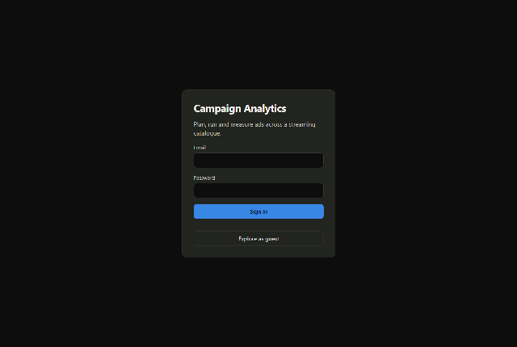
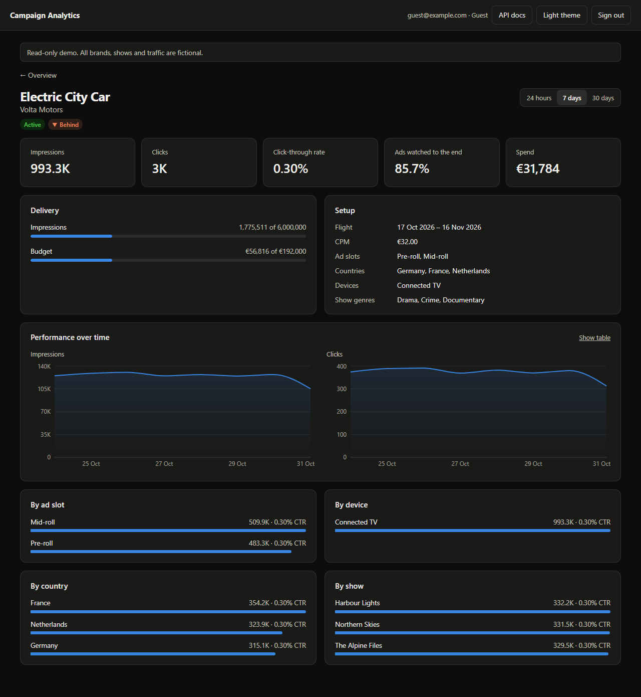
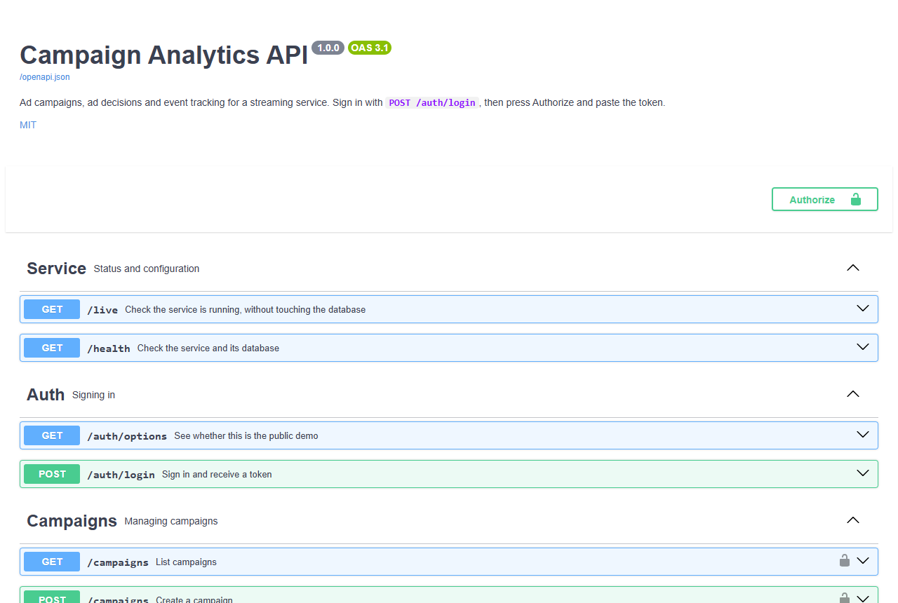
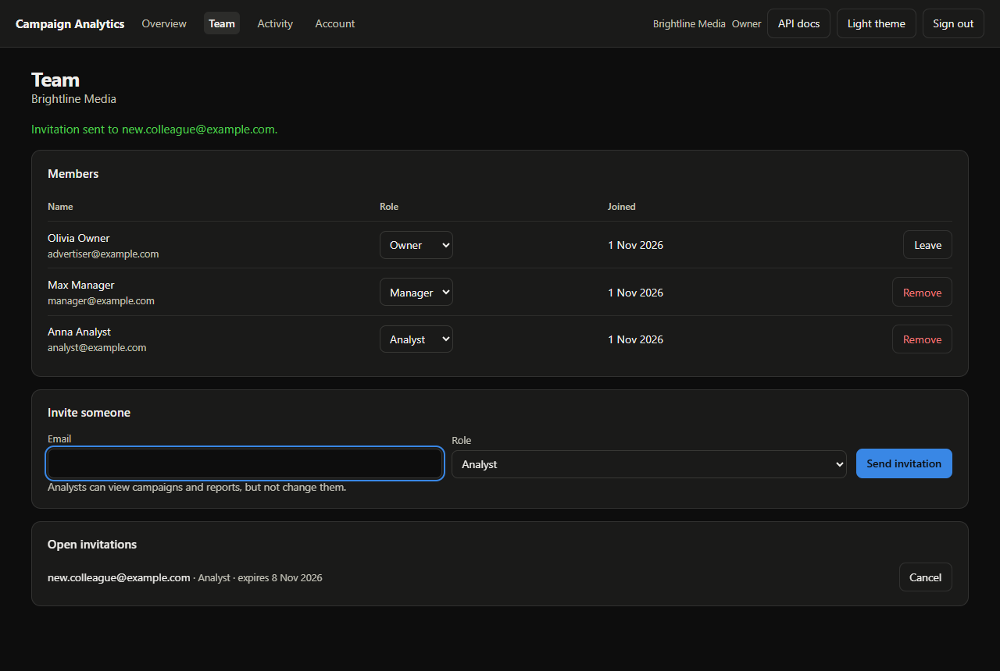
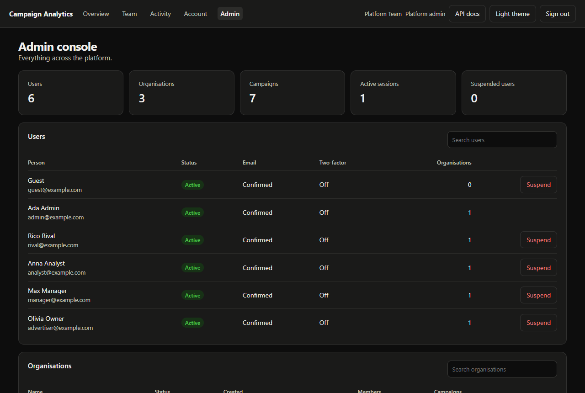

# Campaign Analytics

[](https://github.com/abdullahrather/campaign-analytics-microservice/actions/workflows/ci.yml)
[](./LICENSE)
[](https://github.com/abdullahrather/campaign-analytics-microservice/releases)

An ad platform for a streaming service. Companies plan campaigns as a team, the platform decides which ad plays in each ad break, every view and click is measured, and a live dashboard shows how each campaign is performing.

Built with Node.js, TypeScript, Express, Prisma and PostgreSQL, with a React dashboard. All brands, shows and traffic in the demo are fictional.



| Campaign detail | Interactive API docs |
|---|---|
|  |  |

| Team management | Admin console |
|---|---|
|  |  |

## Run it

You need Node.js 22 or newer. Nothing else: no Docker and no database install.

```bash
npm install
npm run dev
```

Open **http://localhost:5173** and choose a demo account. Interactive API docs are at **http://localhost:3000/docs**. Press `Ctrl+C` to stop.

The first run creates a local PostgreSQL in `.data/`, sets up the tables, and adds 30 days of demo data. Your data stays between runs. To start fresh, stop the app and delete `.data/`.

| Account | Email | Password | Sees |
|---|---|---|---|
| Owner | `advertiser@example.com` | `advert1234` | Brightline Media: campaigns and team |
| Manager | `manager@example.com` | `manager1234` | Brightline Media: campaigns and activity |
| Analyst | `analyst@example.com` | `analyst1234` | Brightline Media: read-only |
| Other company | `rival@example.com` | `rival1234` | Casa Creative, kept apart from Brightline |
| Admin | `admin@example.com` | `admin1234` | Everything, plus the admin console |
| Guest | `guest@example.com` | `guest-demo` | Everything, read-only |

## What it does

Streaming services with an ad tier show short ads before, during and after episodes. Three parties meet here:

- **The advertiser** wants their ad seen by the right people for a set budget.
- **The platform** has to choose an ad for every ad break and keep each campaign on schedule.
- **The viewer** watches, and the player reports what happened.

This app is the part in the middle:

```
 Advertiser ──── dashboard ───▶ Campaigns: budget, dates, targeting
                                    │
 Player: "ad break in this show" ──▶ GET /ad-decision ── picks the best campaign
                                    │
 Player: "it played, was clicked" ─▶ POST /events ────── adds up hourly totals
                                    │
 Advertiser ◀─── live charts ────── Analytics
```

The app includes demo traffic that plays the part of the viewers, so the numbers move while you watch. Run with `SIMULATE=0` to turn it off.

**Things to try:** create a campaign targeting one country and watch it start delivering within seconds. Pause it and see the numbers stop. Compare Connected TV with Mobile on a campaign's page.

### The terms on the dashboard

| Term | Meaning |
|---|---|
| **Impression** | One ad played once to one viewer. |
| **Click-through rate (CTR)** | The share of impressions that were clicked. TV is low because viewers rarely can. |
| **Ads watched to the end** | The share of ads that played to completion. Mid-roll is highest: viewers want the show back. |
| **CPM** | The price per 1,000 impressions. |
| **Ad slot** | Pre-roll (before the episode), mid-roll (during) or post-roll (after). |
| **Flight** | The dates a campaign runs. |
| **Impression goal** | The number of impressions the advertiser bought. |
| **Pacing** | Delivery so far compared with an even schedule. Behind means the campaign may miss its goal. |

### Accounts and teams

Each company is an organisation with its own private campaigns and team. A person can belong to several and switch between them.

| Role | Can do |
|---|---|
| **Owner** | Everything below, plus invite people, change roles and remove members |
| **Manager** | Create and change campaigns, and see team activity |
| **Analyst** | View campaigns and reports |

The platform also has a **sign-up flow** with email confirmation, **password reset**, **two-factor login** with an authenticator app and recovery codes, a list of **signed-in devices**, an **activity log** of who changed what, and an **admin console** for suspending people or organisations.

Emails appear in the **local mailbox** at `/#/mailbox`, so all of this works with no mail server. To send real email, set `SMTP_URL` in `.env`.

### How an ad gets chosen

For each ad break, `/ad-decision` keeps campaigns that are active, inside their dates, under their goal and budget, and matching the country, device, slot and show genre. It then picks the one furthest behind schedule, with the higher CPM winning ties. A campaign is marked completed when it reaches its goal or budget, or passes its end date.

## How it stays secure

- **Passwords** are hashed with bcrypt. Sign-in, sign-up and password reset respond the same way whether or not an account exists.
- **Sessions** use a 15-minute access token held in memory, and a rotating refresh token in an httpOnly cookie. Reusing an old refresh token ends the session.
- **Two-factor sign-in** locks for 15 minutes after five wrong codes, counted per account, and emails the owner.
- **Permissions** are checked against the database on every request, so sign-outs, suspensions and role changes apply immediately.
- **Secrets** are never stored in plain text: email links and recovery codes are hashed, and two-factor secrets are encrypted.

## How it stays fast

- **Hourly rollups.** Events are added into one row per campaign, hour, show, slot, country and device, not stored one by one. The table grows with variety, not with traffic.
- **Batched writes.** A batch of up to 1,000 events becomes a single upsert.
- **One query per view.** Analytics run as a single SQL statement, so more campaigns never means more database round trips.

## API

Interactive docs are at `/docs`, and the raw OpenAPI document is at `/openapi.json`. They are generated from the validation schemas, and a test fails if a route is undocumented.

Dashboard routes need `Authorization: Bearer <token>` from login. Ad server routes need an `x-ingest-key` header.

| Method | Route | Purpose |
|---|---|---|
| `GET` | `/live` | Service status, without using the database |
| `GET` | `/health` | Service and database status |
| `GET` | `/auth/options` | Which sign-in options apply here |
| `POST` | `/auth/register` | Create an account and organisation |
| `POST` | `/auth/login` | Sign in; limited to 20 attempts per 15 minutes |
| `POST` | `/auth/two-factor` | Finish signing in with a code |
| `POST` | `/auth/refresh` | Replace an expired access token |
| `POST` | `/auth/forgot-password` | Send a reset link |
| `GET` | `/auth/me` | Your profile and organisations |
| | `/account/*` | Password, devices and two-factor settings |
| | `/team/*` | Members, invitations and activity |
| | `/admin/*` | The admin console |
| `GET` | `/campaigns` | List campaigns, with `status`, `page` and `limit` |
| `POST` | `/campaigns` | Create a campaign |
| `GET` | `/campaigns/:id` | Read a campaign |
| `PATCH` | `/campaigns/:id` | Change a campaign, including pausing and resuming |
| `DELETE` | `/campaigns/:id` | Delete a campaign and its metrics |
| `GET` | `/campaigns/analytics` | Totals, pacing and spend per campaign, with `from` and `to` |
| `GET` | `/campaigns/analytics/timeseries` | Performance over time across campaigns |
| `GET` | `/campaigns/:id/analytics` | One campaign with its trend and breakdowns |
| `GET` | `/shows` | The show catalogue |
| `GET` | `/ad-decision` | Choose an ad: `showId`, `slot`, `country`, `device` |
| `POST` | `/events` | Record `IMPRESSION`, `CLICK` and `COMPLETION` events |

## Project layout

```
prisma/          Database schema, migrations and demo data
scripts/         Local database and dev startup
src/modules/     account, admin, audit, auth, campaigns, delivery, demo, dev, docs, shows, team
src/middleware/  Sign-in and permission guards, API key guard, error handling
tests/           Integration tests against a real PostgreSQL
web/             The React dashboard
```

## Scripts

| Script | Purpose |
|---|---|
| `npm run dev` | Start everything |
| `npm test` | Run the integration tests |
| `npm run test:coverage` | Tests with a coverage report |
| `npm run lint` | Lint the API |
| `npm run format` | Format the code |
| `npm run typecheck` | Check TypeScript types |
| `npm run build` | Compile the API |
| `npm run db:seed` | Replace all data with fresh demo data |
| `npm run db:studio` | Browse the database in Prisma Studio |

## Docker

With Docker installed, this runs the database and the app at **http://localhost:3000**:

```bash
docker compose up --build
```

For a real deployment, build the `production` image target and set `DATABASE_URL`, `JWT_SECRET` and `INGEST_API_KEY`. The app refuses to start in production with the placeholder secrets.

## Public demo

`render.yaml` deploys a read-only demo: the app on Render's free plan, and its database on Neon's free plan. Demo mode leaves only the guest account with a known password, runs traffic only while someone is viewing, and refreshes its data when it's more than a week old. The first visit after a quiet period takes about a minute while the app wakes up.

## Known limits

This is a working demonstration, not a system that has run under real load.

- Sending the same event batch twice counts it twice, because events have no IDs.
- Budgets and goals are checked as events arrive, so a campaign can slightly overshoot under heavy traffic.
- Each ad decision adds up the campaign's delivery. Real ad traffic would need a cache in front of this.
- `/ad-decision` and `/events` share one API key, which suits a trusted ad server, not code running on viewers' devices.
- Sign-ups and invitations need `SMTP_URL` for real email; without it, messages stay in the local mailbox.

## Contributing

See [CONTRIBUTING.md](./CONTRIBUTING.md). Released under the [MIT License](./LICENSE).
