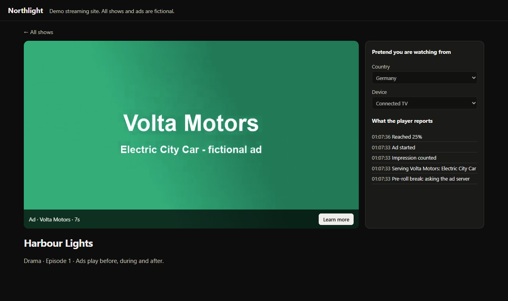
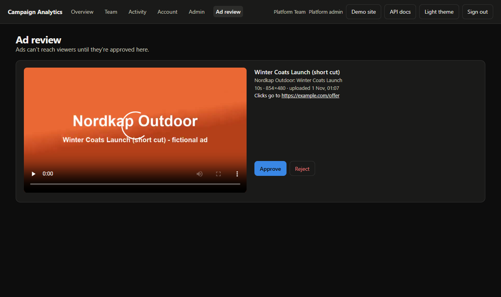

# Campaign Analytics

[](https://github.com/abdullahrather/streaming-ad-platform/actions/workflows/ci.yml)
[](./LICENSE)
[](https://github.com/abdullahrather/streaming-ad-platform/releases)

An ad platform for a streaming service. Companies upload video ads and plan campaigns as a team, the platform decides which ad plays in each ad break, a real player shows it, every view and click is measured, and a live dashboard shows how each campaign is performing.

Built with Node.js, TypeScript, Express, Prisma, PostgreSQL, Redis and FFmpeg, with a React dashboard. It has been load-tested at 10,000 events per second for five minutes with none lost or double-counted, including through a worker crash. See the [load test results](./docs/load-test.md). All brands, shows and traffic in the demo are fictional.


| Campaign detail | Interactive API docs |
|---|---|
|  |  |

| Demo streaming site | Ad review |
|---|---|
|  |  |

| Team management | Admin console |
|---|---|
|  |  |

## Run it

You need Node.js 22 or newer and [Docker Desktop](https://www.docker.com/products/docker-desktop/), which runs Redis. PostgreSQL and FFmpeg install with the project.

```bash
npm install
npm run dev
```

Open **http://localhost:5173** and choose a demo account. The demo streaming site is at **http://localhost:5173/watch**, and interactive API docs are at **http://localhost:3000/docs**. Press `Ctrl+C` to stop.

The first run creates a local PostgreSQL in `.data/`, sets up the tables, and adds 30 days of demo data, including short fictional videos made with FFmpeg. Your data stays between runs. To start fresh, stop the app, delete `.data/`, and run `docker compose down -v`.

Redis keeps running in Docker after you stop the app, so queued events are safe. To stop it, run `docker compose stop redis`.

| Account | Email | Password | Sees |
|---|---|---|---|
| Owner | `advertiser@example.com` | `advert1234` | Brightline Media: campaigns and team |
| Manager | `manager@example.com` | `manager1234` | Brightline Media: campaigns and activity |
| Analyst | `analyst@example.com` | `analyst1234` | Brightline Media: read-only |
| Other company | `rival@example.com` | `rival1234` | Casa Creative, kept apart from Brightline |
| Admin | `admin@example.com` | `admin1234` | Everything, plus the admin console |
| Guest | `guest@example.com` | `guest-demo` | Everything, read-only |

## What it does

Streaming services with an ad tier show short ads before, during and after episodes. Three parties meet here:

- **The advertiser** wants their ad seen by the right people for a set budget.
- **The platform** has to choose an ad for every ad break and keep each campaign on schedule.
- **The viewer** watches, and the player reports what happened.

This app is the part in the middle:

```
 Advertiser ──── dashboard ───▶ Campaigns: budget, dates, targeting
                                    │
 Player: "ad break in this show" ──▶ GET /ad-decision ── picks the best campaign
                                    │
 Player: "it played, was clicked" ─▶ POST /events ────── adds up hourly totals
                                    │
 Advertiser ◀─── live charts ────── Analytics
```

The app includes demo traffic that plays the part of the viewers, so the numbers move while you watch. Run with `SIMULATE=0` to turn it off.

**Things to try:** create a campaign targeting one country and watch it start delivering within seconds. Pause it and see the numbers stop. Compare Connected TV with Mobile on a campaign's page.

### From upload to playback

1. **Upload.** A manager uploads a video to a campaign. Files that aren't real videos, last under 5 or over 120 seconds, or are too small are refused straight away.
2. **Convert.** FFmpeg turns the upload into web-friendly H.264 in the background, with a preview image.
3. **Review.** A platform admin watches it on the **Ad review** page and approves or rejects it. The uploader is told by email. Until then the video stays private.
4. **Play.** Open the demo site and press play. Ads run before, during and after the episode, and a side panel shows each event the player reports.
5. **Measure.** Impressions, the 25%, 50% and 75% marks, completions and clicks reach the campaign's page, including a chart of how far viewers watch.

Run with `SIMULATE=0` to turn off demo traffic, and the dashboard shows only what you played yourself.

### The terms on the dashboard

| Term | Meaning |
|---|---|
| **Impression** | One ad played once to one viewer. |
| **Click-through rate (CTR)** | The share of impressions that were clicked. TV is low because viewers rarely can. |
| **Ads watched to the end** | The share of ads that played to completion. Mid-roll is highest: viewers want the show back. |
| **CPM** | The price per 1,000 impressions. |
| **Creative** | The video ad itself. A campaign can have several, and one is picked at random. |
| **VAST** | The ad industry's standard XML format, which tells a video player what to play and where to report. |
| **Quartile** | The 25%, 50% and 75% points of an ad, used to see where viewers stop watching. |
| **Ad slot** | Pre-roll (before the episode), mid-roll (during) or post-roll (after). |
| **Flight** | The dates a campaign runs. |
| **Impression goal** | The number of impressions the advertiser bought. |
| **Pacing** | Delivery so far compared with an even schedule. Behind means the campaign may miss its goal. |

### Accounts and teams

Each company is an organisation with its own private campaigns and team. A person can belong to several and switch between them.

| Role | Can do |
|---|---|
| **Owner** | Everything below, plus invite people, change roles and remove members |
| **Manager** | Create and change campaigns, and see team activity |
| **Analyst** | View campaigns and reports |

The platform also has a **sign-up flow** with email confirmation, **password reset**, **two-factor login** with an authenticator app and recovery codes, a list of **signed-in devices**, an **activity log** of who changed what, and an **admin console** for suspending people or organisations.

Emails appear in the **local mailbox** at `/#/mailbox`, so all of this works with no mail server. To send real email, set `SMTP_URL` in `.env`.

### How an ad gets chosen

For each ad break, `/ad-decision` keeps campaigns that are active, inside their dates, under their goal and budget, and matching the country, device, slot and show genre. It then picks the one furthest behind schedule, with the higher CPM winning ties. A campaign is marked completed when it reaches its goal or budget, or passes its end date.

Real players use `/vast`, which only considers campaigns with an approved ad. `/ad-decision` also includes campaigns without one, which lets ad servers and demo traffic run on numbers alone.

## How it stays secure

- **Passwords** are hashed with bcrypt. Sign-in, sign-up and password reset respond the same way whether or not an account exists.
- **Sessions** use a 15-minute access token held in memory, and a rotating refresh token in an httpOnly cookie. Reusing an old refresh token ends the session.
- **Two-factor sign-in** locks for 15 minutes after five wrong codes, counted per account, and emails the owner.
- **Uploads** are treated as untrusted: FFmpeg is limited to local files and runs without a shell, and the original is deleted after conversion.
- **Players use 15-minute tokens.** A publisher's server exchanges its secret key for one with `POST /player-tokens`, so the key never reaches a device.
- **Invalid traffic is filtered.** Bots, viewers requesting too many ads, and ads finished impossibly fast are removed from results and reported on the campaign's page.
- **Player events** use signed links from the VAST response, so players hold no secret and can't report on another campaign.
- **Permissions** are checked against the database on every request, so sign-outs, suspensions and role changes apply immediately.
- **Secrets** are never stored in plain text: email links and recovery codes are hashed, and two-factor secrets are encrypted.

## Using it with other video players

`/vast` returns standard VAST 4.2 and allows requests from any website, so any VAST-compatible player can show these ads. It needs a player token. `web/src/player/ad-sdk.ts` is a small player SDK with no dependencies:

```ts
const ad = await requestAd({ serverUrl: '/vast', token, showId, slot: 'PRE_ROLL', country: 'DE', device: 'CTV' });
if (ad) await playAd(videoElement, ad, { onEvent: console.log });
```

## How events are counted

Events go through a queue, so the API stays fast and a failure can't lose or repeat them:

```
 Player or ad server
       │  each event has a unique ID
       ▼
 API ──▶ Redis script: drop IDs already seen, queue the rest (one atomic step)
                                │
                                ▼
 Worker ──▶ PostgreSQL transaction: save the totals and the queue entry's ID together
                                │
                                ▼
                     Remove the entry from the queue
```

- **A retry can't count twice.** Repeated event IDs are dropped, so sending a batch again is always safe. Events older than the one-hour duplicate window are refused.
- **A crash can't lose events.** An entry stays on the queue until its totals are saved. If a worker dies, another picks up its work.
- **A crash can't count twice.** The queue entry's ID is saved in the same transaction as the totals, so an entry redelivered after a crash changes nothing.

## How it stays fast

- **Decisions use no database.** Running campaigns are kept in memory and live delivery counts in Redis.
- **Limits are reserved, not checked afterwards.** Each ad is claimed in one atomic step, so a campaign can't pass its goal or budget, however many requests race.
- **Hourly rollups.** Events are added into one row per campaign, hour, show, slot, country and device, not stored one by one. The table grows with variety, not with traffic.
- **Batched writes.** The worker turns thousands of events into a few upserts.
- **One query per view.** Analytics run as a single SQL statement, so more campaigns never means more database round trips.

## API

Interactive docs are at `/docs`, and the raw OpenAPI document is at `/openapi.json`. They are generated from the validation schemas, and a test fails if a route is undocumented.

Dashboard routes need `Authorization: Bearer <token>` from login. Ad server routes need an `x-ingest-key` header.

| Method | Route | Purpose |
|---|---|---|
| `GET` | `/live` | Service status, without using the database |
| `GET` | `/health` | Service and database status |
| `GET` | `/auth/options` | Which sign-in options apply here |
| `POST` | `/auth/register` | Create an account and organisation |
| `POST` | `/auth/login` | Sign in; limited to 20 attempts per 15 minutes |
| `POST` | `/auth/two-factor` | Finish signing in with a code |
| `POST` | `/auth/refresh` | Replace an expired access token |
| `POST` | `/auth/forgot-password` | Send a reset link |
| `GET` | `/auth/me` | Your profile and organisations |
| `GET` | `/creatives` | List a campaign's video ads |
| `POST` | `/creatives` | Upload a video ad |
| `POST` | `/player-tokens` | Exchange the ad server key for a player token |
| `GET` | `/vast` | Get an ad as VAST XML, for video players |
| `GET` | `/track/{event}` | Report ad progress, with a signed link from the VAST |
| `GET` | `/click` | Record a click and redirect |
| `GET` | `/player/catalogue` | Shows the demo site can play |
| | `/account/*` | Password, devices and two-factor settings |
| | `/team/*` | Members, invitations and activity |
| | `/admin/*` | The admin console |
| `GET` | `/campaigns` | List campaigns, with `status`, `page` and `limit` |
| `POST` | `/campaigns` | Create a campaign |
| `GET` | `/campaigns/:id` | Read a campaign |
| `PATCH` | `/campaigns/:id` | Change a campaign, including pausing and resuming |
| `DELETE` | `/campaigns/:id` | Delete a campaign and its metrics |
| `GET` | `/campaigns/analytics` | Totals, pacing and spend per campaign, with `from` and `to` |
| `GET` | `/campaigns/analytics/timeseries` | Performance over time across campaigns |
| `GET` | `/campaigns/:id/analytics` | One campaign with its trend and breakdowns |
| `GET` | `/shows` | The show catalogue |
| `GET` | `/ad-decision` | Choose an ad: `showId`, `slot`, `country`, `device` |
| `POST` | `/events` | Queue a batch of ad events, each with an `eventId` and `occurredAt` |

## Project layout

```
prisma/          Database schema, migrations and demo data
scripts/         Local database and dev startup
src/lib/         Storage, video conversion, email, security
src/modules/     account, admin, audit, auth, campaigns, creatives, delivery, demo, dev, docs,
                 playback, shows, team
src/middleware/  Sign-in and permission guards, API key guard, error handling
tests/           Integration tests against a real PostgreSQL
web/             The React dashboard, the demo streaming site and the player SDK
```

## Scripts

| Script | Purpose |
|---|---|
| `npm run dev` | Start everything |
| `npm test` | Run the integration tests |
| `npm run test:coverage` | Tests with a coverage report |
| `npm run lint` | Lint the API |
| `npm run format` | Format the code |
| `npm run typecheck` | Check TypeScript types |
| `npm run build` | Compile the API |
| `npm run load:test` | Run the load test and check the totals |
| `npm run db:seed` | Replace all data with fresh demo data |
| `npm run db:studio` | Browse the database in Prisma Studio |

## Docker

With Docker installed, this runs the database and the app at **http://localhost:3000**:

```bash
docker compose up --build
```

For a real deployment, build the `production` image target and set `DATABASE_URL`, `JWT_SECRET` and `INGEST_API_KEY`. The app refuses to start in production with the placeholder secrets.

## Public demo

`render.yaml` deploys a read-only demo: the app and Redis on Render's free plans, and its database on Neon's free plan. This setup hasn't been tested with Redis. Demo mode leaves only the guest account with a known password, runs traffic only while someone is viewing, and refreshes its data when it's more than a week old. The first visit after a quiet period takes about a minute while the app wakes up.

## Known limits

This is a working demonstration, not a system that has run under real load.

- Videos are stored on local disk and streamed by the app, with no CDN or adaptive quality. The storage layer is ready for cloud storage.
- The demo player takes its country and device from a menu, where a real service would detect them.
- A reserved ad that never plays is only returned after its campaign has been quiet for two minutes, so a campaign near its limit can briefly under-deliver.
- Dashboard totals lag slightly behind live traffic, because events pass through the queue first.
- `/ad-decision` and `/events` share one API key, which suits a trusted ad server.
- Sign-ups and invitations need `SMTP_URL` for real email; without it, messages stay in the local mailbox.

## Contributing

See [CONTRIBUTING.md](./CONTRIBUTING.md). Released under the [MIT License](./LICENSE).
